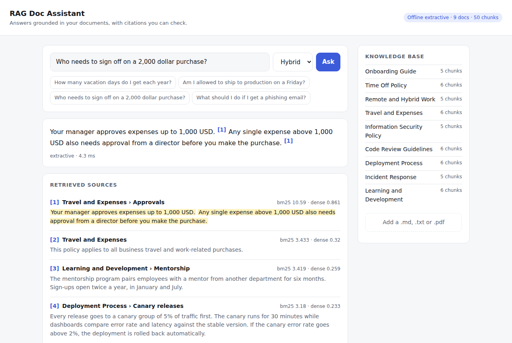
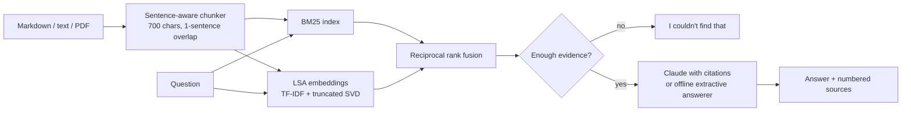

# RAG Doc Assistant

**Ask questions about your own documents and get answers with citations you can check.**

[](https://github.com/Krishna-44/rag-doc-assistant/actions/workflows/ci.yml)


[](LICENSE)

<picture>
  <source media="(prefers-color-scheme: dark)" srcset="docs/screenshot-dark.png">
  
</picture>

A retrieval-augmented generation (RAG) system built from first principles: sentence-aware
chunking, a hand-written BM25 index, dense retrieval, hybrid rank fusion, grounded generation with
Claude's native citations, an abstention policy for out-of-scope questions, and an evaluation
harness that measures retrieval quality instead of eyeballing it.

It runs **fully offline** out of the box (an extractive answerer stands in for the LLM), so you can
clone it and try it in under a minute. Set `ANTHROPIC_API_KEY` and the same pipeline answers with
Claude.

## Features

- **Hybrid retrieval** — BM25 (implemented from scratch) for exact terms like "1,000 USD", dense
  LSA embeddings for related wording, fused with reciprocal rank fusion (no score calibration
  needed).
- **Verifiable answers** — with Claude, each retrieved chunk is sent as a `document` block with
  citations enabled, so every claim maps to the exact source sentence. The UI highlights it.
- **Knows when it doesn't know** — an IDF-weighted coverage check skips generation for questions
  the corpus can't answer ("What is the capital of France?") instead of producing a confident
  wrong answer.
- **Measured, not guessed** — `ragdoc eval` reports Recall@k and MRR for every retriever on a
  labelled question set; CI fails if recall regresses.
- **Usable three ways** — a CLI, a REST API (FastAPI, OpenAPI docs at `/docs`) and a web UI with
  document upload (`.md`, `.txt`, `.pdf`).

## How it works



1. **Chunking** (`chunking.py`) splits on sentence boundaries, never across Markdown headings, and
   keeps exact character offsets plus the section title of every chunk. The title and section are
   indexed with the chunk, so "Approvals" in a heading helps match approval questions.
2. **Retrieval** (`retrieval.py`) scores every chunk with BM25 and cosine similarity, then fuses the
   top 20 of each ranking with RRF (`1 / (60 + rank)`).
3. **Abstention** (`pipeline.py`) checks how much of the question (weighted by IDF) the best chunks
   cover, and how semantically close they are. The dense score is discounted by how much of the
   question is in the corpus vocabulary, because LSA silently ignores unknown words.
4. **Generation** (`generation.py`) calls Claude (`claude-opus-5-5`) with the chunks as citable
   documents, or picks the best-matching sentences offline. Both return the same `Answer` object.

## Quick start

```bash
git clone https://github.com/Krishna-44/rag-doc-assistant.git
cd rag-doc-assistant
python -m venv .venv && source .venv/bin/activate
pip install -e ".[dev,pdf]"

ragdoc ask "Am I allowed to ship to production on a Friday?"
ragdoc serve            # web UI on http://127.0.0.1:8000, API docs on /docs
```

```text
$ ragdoc ask "Who needs to sign off on a 2,000 dollar purchase?"
Your manager approves expenses up to 1,000 USD. [1] Any single expense above 1,000 USD also needs
approval from a director before you make the purchase. [1]

 *[1] Travel and Expenses › Approvals  (score 0.033)
  [2] Travel and Expenses  (score 0.032)
  ...
```

**Use your own documents:** `ragdoc --docs path/to/folder ask "..."`, or upload files in the web UI.

**Answer with Claude:** `export ANTHROPIC_API_KEY=...` and run the same commands. Force a
generator with `--generator claude|extractive`; set `RAGDOC_MODEL` to change the model.

**Docker:**

```bash
docker build -t rag-doc-assistant .
docker run -p 8000:8000 -e ANTHROPIC_API_KEY rag-doc-assistant
```

The bundled corpus is a handbook for **Lumen Labs, a fictional company** — nine short policy
documents (time off, expenses, security, deployments, incidents, …) written for this project.

## Evaluation

`eval/questions.jsonl` holds 34 questions written to *paraphrase* the documents rather than copy
them ("Can I fly business class?" for a policy that says "premium economy"). Each question is
labelled with its source document and a short evidence span; a retrieved chunk is relevant if it
contains that span, so the labels survive changes to chunk size.

```text
$ ragdoc eval
34 questions · 9 documents · 50 chunks
```

| Retriever | Recall@1 | Recall@3 | Recall@5 | MRR@10 |
|---|---:|---:|---:|---:|
| bm25 | 0.706 | 0.912 | 0.912 | 0.802 |
| dense | 0.676 | 0.882 | 0.912 | 0.785 |
| hybrid | 0.706 | 0.882 | 0.912 | 0.799 |

**Reading these numbers honestly:**

- On a corpus this small, all three retrievers are within one question of each other (one question
  is ~0.03). The value of hybrid search here is robustness, not a headline gain; the benchmark is
  there to catch regressions and to compare real embedding models on your own data.
- **Error analysis.** The misses are vocabulary mismatches that a bag-of-words model can't bridge:
  "medical certificate … ill" vs. "doctor's note … sick leave", or "full outage" vs. "SEV1 … product is
  down". LSA only learns associations that co-occur in the corpus itself. A neural embedding model
  (sentence-transformers, Voyage, etc.) is the fix — plug it in through the `Embedder` protocol in
  `retrieval.py` and re-run `ragdoc eval`.
- **Abstention.** With the default thresholds, all three out-of-scope questions in the test suite
  abstain, and the only in-scope question that abstains is the "medical certificate" one, where
  retrieval itself failed. The thresholds were chosen on this sample set; re-check them on yours.

## API

| Method | Path | Description |
|---|---|---|
| `POST` | `/api/ask` | `{"question", "k"?, "mode"?}` → answer, citations, sources, latency |
| `POST` | `/api/search` | Ranked chunks with BM25, dense and fused scores |
| `GET` | `/api/documents` | Indexed documents and chunk counts |
| `POST` | `/api/documents` | Upload a `.md`/`.txt`/`.pdf` (max 5 MB) and re-index |
| `GET` | `/api/health` | Status, active generator, corpus size |

Interactive docs are served at `/docs`. LLM failures are returned as `502` with a readable message
(authentication, rate limit, connectivity) rather than crashing the server.

## Project structure

```text
src/ragdoc/
├── text.py            tokenising, stemming, sentence splitting with exact offsets
├── documents.py       Markdown / text / PDF loaders
├── chunking.py        sentence-aware chunks with overlap and section tracking
├── retrieval.py       BM25, LSA embedder, reciprocal rank fusion, Retriever
├── knowledge_base.py  documents → chunks → index
├── generation.py      ClaudeGenerator (native citations) and ExtractiveGenerator
├── pipeline.py        retrieve → abstain? → generate
├── evaluation.py      Recall@k, MRR, evaluation runner
├── api.py             FastAPI app
├── cli.py             `ragdoc` command
└── static/index.html  web UI (no build step)
tests/                 39 tests: chunking, ranking math, generators, pipeline, API
eval/questions.jsonl   labelled retrieval benchmark
```

## Testing

```bash
pytest -q          # 39 tests, ~2 s, no network or API key needed
ruff check .
ragdoc eval
```

The Claude generator is tested against the Messages API response shape (text blocks with
`char_location` citations, thinking blocks, refusals) using a fake client, so the suite runs without
credentials. CI runs lint, tests and the retrieval benchmark on Python 3.10–3.12.

## Design decisions

- **Why build BM25 and chunking by hand?** To understand and control every step: offsets for
  highlighting, section-aware chunks, and an IDF table reused by the abstention check. The
  `Retriever` interface means a vector database can replace it without touching the rest.
- **Why LSA for dense retrieval?** It needs no model download or GPU, so the project runs anywhere,
  including CI. It's the weakest part of the system and is designed to be swapped out.
- **Why native citations instead of asking the model to write `[1]`?** Citations returned by the API
  point at exact character ranges in the supplied documents, so they can't be hallucinated.
- **Why an in-memory index?** A few hundred pages index in well under a second at start-up, which
  keeps the deployment to a single stateless container.

## Roadmap

- [ ] Neural embeddings behind the `Embedder` protocol, compared with `ragdoc eval`
- [ ] Cross-encoder re-ranking of the fused top-20
- [ ] Answer-quality evaluation (faithfulness of the generated text to its citations)
- [ ] Persistent index for large corpora

## License

[MIT](LICENSE) © Krishna Goyal
